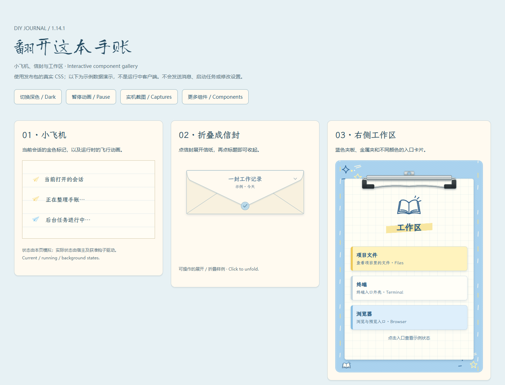

# DIY Journal

A notebook-inspired Harness skin with paper, tape, framed photos, paper planes,
folding envelopes and an address-book remote-access panel.

[中文](README.md) · [Install / update / remove](INSTALL.md) · [Skin guide](skins/diy-journal/README.md) · [Feature tour](docs/FEATURES.md) · [Optional editor](https://github.com/Alphazerolan/diy-journal-settings)

## Highlights

- Illustrated home and settings pages, book-like sidebar and paper account cards.
- Paper-plane status treatments, collapsible envelope and blue workspace clipboard.
- Matching automation menus, approval cards, tool panels and opaque dialogs.
- Separate editor for photos, layouts, position, rotation, borders, captions and tape.

Download the full repository and open `docs/demo/index.html` to explore theme,
motion, envelope and workspace sample states. These use shipped CSS with fictional
data, not a live Harness connection. See the [full tour](docs/FEATURES.md).

## Actual app captures

Full sidebar retained; personal text masked and the unrelated unlicensed pet
hidden before capture. Light and dark were selected in the actual app.

## Provenance and maintenance

The 14 default illustrations were generated with ChatGPT. See [artwork records](skins/diy-journal/ARTWORK.json)
and [NOTICE](skins/diy-journal/NOTICE). Reference-character clearance remains
unverified and disclosed in the draft submission. No personal input photos or pet
artwork are bundled.

[Code license](LICENSE) · [Artwork statement](LICENSE-ARTWORK) · [Verification](VERIFICATION.md) · [Changelog](CHANGELOG.md) · [Contributing](CONTRIBUTING.md) · [Reference audit](docs/REFERENCE-AUDIT.md)
