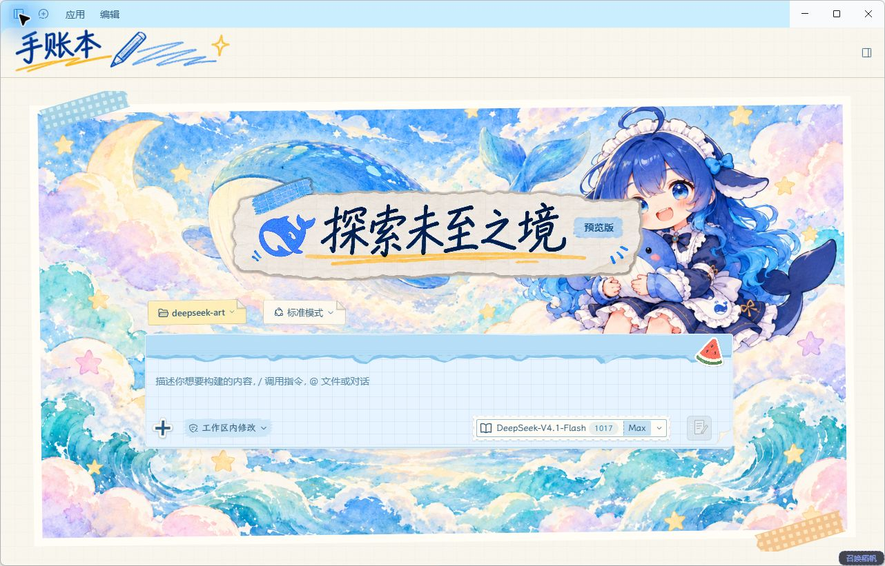
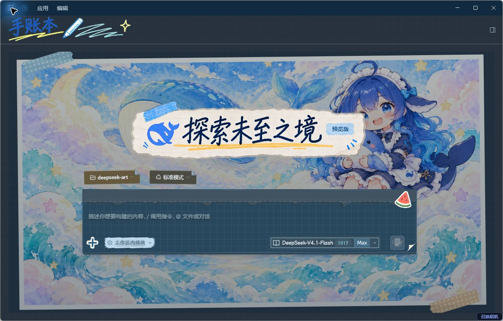
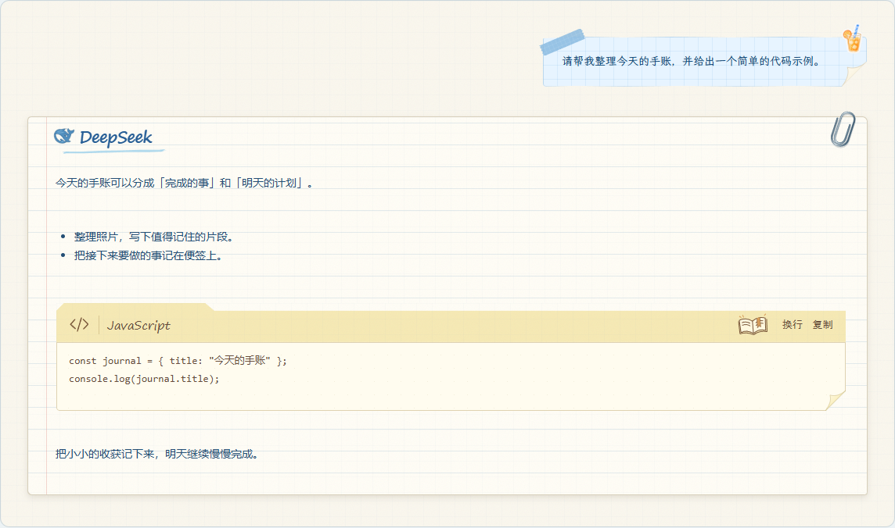
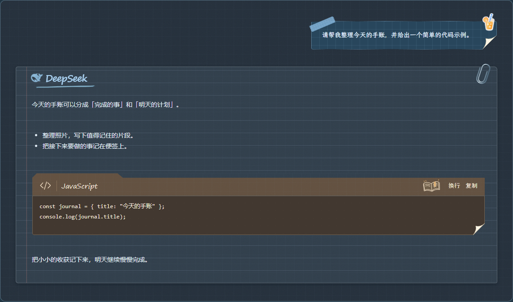
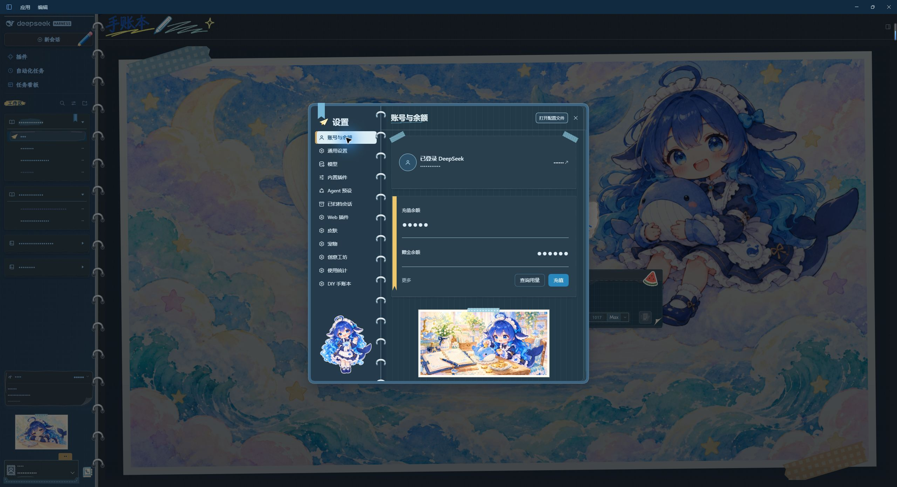

# DIY Journal

A notebook-inspired skin for DeepSeek Harness (DSH), restyling as many interface
components as the developer could think of—from the home screen, sidebars and
conversation bubbles to menus, cards and tool panels. [See the style preview](#preview).

To bring the freedom of a scrapbook to the skin, we also created the
[DIY Journal style menu plugin](https://github.com/Alphazerolan/diy-journal-settings).
Use it to adjust layouts and styles in each area, replace images, and combine tape,
photo borders and captions to make the journal your own.

[中文](README.md) · [Install and update](INSTALL.md) · [Detailed guide](skins/diy-journal/README.md)

## Use

Copy `skins/diy-journal` into the Harness skin directory, then select **DIY Journal**
in Settings → Skins. See the [installation guide](INSTALL.md) for paths and updates.

**Default artwork and styles are included. Neither the editor plugin nor Python is required to use the skin.**

The optional style menu plugin currently supports Windows and requires Python 3.9+.

## Preview

### Home · Light

### Home · Dark

### Conversation bubbles · User and DeepSeek replies

User messages use blue grid-paper notes. DeepSeek replies use lined paper with a
handwritten signature and a paper clip, with folded-paper styling for code blocks.
The following sample conversation is rendered with the skin's styles.

**Light**

**Dark**

### Settings · Light

### Settings · Dark

## Compatibility

Uses the v2 skin format with light and dark palettes. Some dynamic state enhancements
require host approval of optional hooks. Layout rules may need updates when Harness changes.

## Artwork and licensing

The 14 default illustrations were generated with ChatGPT; see [ARTWORK.json](skins/diy-journal/ARTWORK.json).
Reference-character rights and redistribution permission remain unverified. This
is not official DeepSeek artwork or an officially authorized project. Character,
artwork and font details are in [NOTICE](skins/diy-journal/NOTICE).

[Code license](LICENSE) · [Artwork license scope](LICENSE-ARTWORK) · [Changelog](CHANGELOG.md) · [Contributing](CONTRIBUTING.md)
