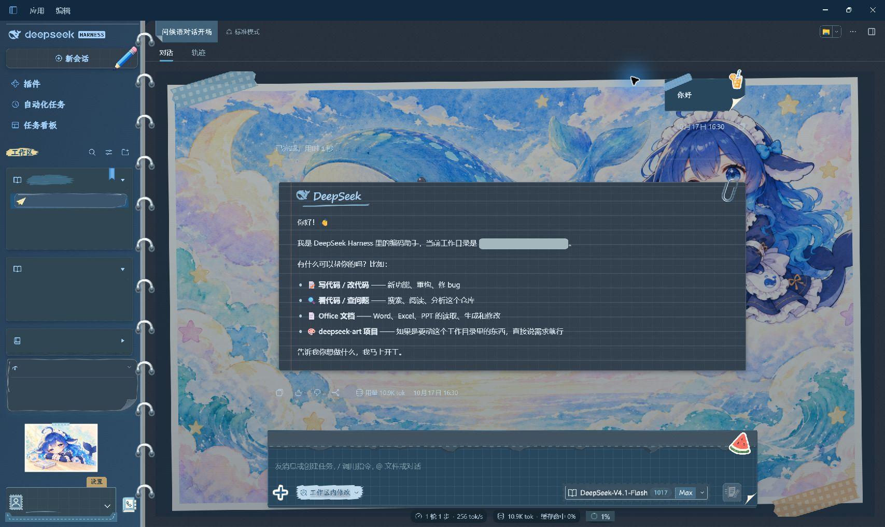

# DIY 手账本

本皮肤以手账本为主题，为 DeepSeek Harness（DSH）重绘了开发者尽可能想到的界面组件，从主界面、侧栏、对话气泡，到菜单、卡片和工具面板，让日常使用也有翻阅手账的感觉。[查看样式预览](#效果预览)。

为了贴合手账本自由拼贴的特性，我们还制作了 [DIY 手账本样式菜单插件](https://github.com/Alphazerolan/diy-journal-settings)。你可以在插件中调整各个位置的布局与样式、更换图片，还能搭配胶带、白边和题字，组装属于自己的手账本。

[English](README.en.md) · [安装与更新](INSTALL.md) · [组件静态预览](docs/COMPONENTS.md) · [详细说明](skins/diy-journal/README.zh.md)

## 使用

将 `skins/diy-journal` 放入 Harness 的皮肤目录，然后在“设置 → 皮肤”中选择“DIY手账本”。具体路径与更新方法见[安装说明](INSTALL.md)。

**默认配图与样式已包含在皮肤包中，无需安装样式菜单，也不需要 Python。**

样式菜单为可选插件，目前支持 Windows，需要 Python 3.9+。

## 效果预览

以下为 DSH 实机截图。气泡、小飞机、折叠信封、菜单与工具面板等局部样式，见[组件静态预览展示](docs/COMPONENTS.md)（含浅色／深色）。

### 主界面 · 浅色

### 主界面 · 深色

### 对话气泡 · 用户与 DeepSeek 回复

用户消息采用蓝色方格便签，DeepSeek 回复采用带手写署名与回形针的横线信纸。以下为 DSH 实际运行窗口截图，保留完整侧栏；个人信息已隐藏，浅色与深色均在应用中切换后拍摄。

**浅色**

**深色**

### 设置 · 浅色

### 设置 · 深色

## 兼容性

采用 v2 皮肤格式，支持浅色与深色。部分动态状态增强需要宿主批准可选钩子；Harness 界面升级后，部分样式可能需要适配。

## 素材与许可

默认 14 张配图由 ChatGPT 生成，记录见 [ARTWORK.json](skins/diy-journal/ARTWORK.json)。参考角色的权利与再分发授权尚未核实；本项目不是 DeepSeek 官方美术或官方授权项目。角色、素材及字体说明见 [NOTICE](skins/diy-journal/NOTICE)。

[代码许可](LICENSE) · [素材许可范围](LICENSE-ARTWORK) · [更新记录](CHANGELOG.md) · [贡献说明](CONTRIBUTING.md)
