# 组件静态预览 / Static component previews

[返回首页 / Back to README](../README.md) · [实机窗口截图 / Actual DSH windows](../README.md#效果预览) · [DIY 样式菜单 / DIY style menu](https://github.com/Alphazerolan/diy-journal-settings)

这里按组件分类展示皮肤的静态效果，使用当前发布皮肤的样式与示例数据生成。它们不是 DSH 实机截图，也不会执行任务。主界面、完整侧栏与设置页的实际效果请查看首页截图。

These static examples use the released skin styles and sample data. They are not screenshots of a running DSH window. See the README for actual home, sidebar and settings captures.

每组包含浅色与深色，可展开查看深色版本。图片不包含个人信息或宠物。此页展示列出的组件，具体排版可能随 DSH 版本、窗口大小和内容变化。

Each group includes light and dark variants. Expand the dark preview below each image. No personal information or pet artwork is included. Layout may vary with DSH version, window size and content.

## 目录 / Contents

- [对话气泡 / Conversation bubbles](#messages)
- [输入区 / Composer](#composer)
- [小飞机、信封与工作区 / Planes, envelope and workspace](#sidebar-envelope-workspace)
- [展开信封 / Open envelope](#envelope-open)
- [任务组件 / Tasks](#tasks)
- [交付文件 / Deliverables](#files)
- [会话统计 / Session statistics](#stats)
- [菜单与时间选择 / Menus and time picker](#menus)
- [审批、问题与插件卡片 / Approval, question and plugin cards](#cards)
- [工具面板 / Tool panels](#panels)
- [通用弹窗 / Generic dialogs](#dialogs)

## 对话气泡 / Conversation bubbles

用户方格便签、助手横线信纸、署名、回形针与代码块。 / Grid-paper user notes, lined assistant replies, signature, paper clip and code block.

**浅色 / Light**

深色 / Dark

## 输入区 / Composer

可撕方格本、西瓜装饰及工作区、模式、分支纸签。 / Tear-off grid paper, watermelon decoration and workspace, mode and branch labels.

**浅色 / Light**

深色 / Dark

## 小飞机、信封与工作区 / Planes, envelope and workspace

会话状态标记、折叠信封，以及右侧夹板上的文件、终端和浏览器入口。动画在图中展示为静止状态。 / Session markers, a folded envelope and the right-hand workspace clipboard. Animation is shown as a still frame.

**浅色 / Light**

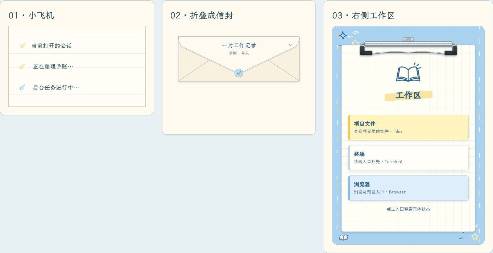

深色 / Dark

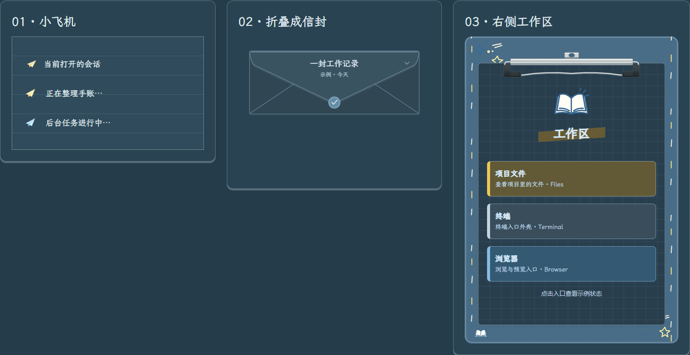

## 展开信封 / Open envelope

展开后的信纸与信封袋。 / Unfolded letter and envelope pocket.

**浅色 / Light**

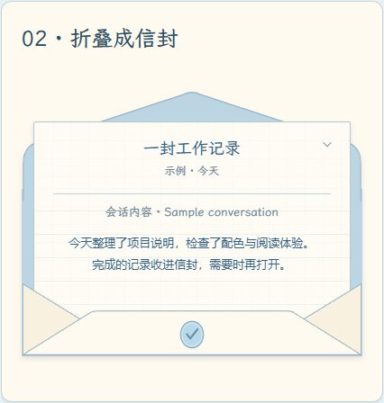

深色 / Dark

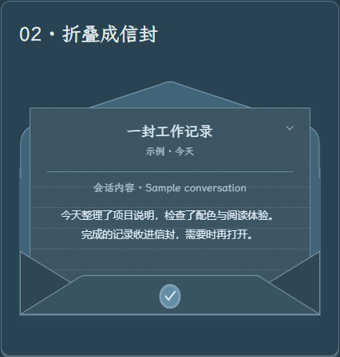

## 任务组件 / Tasks

子智能体任务列表与待办事项，包含进行中和已完成状态。 / Subagent task list and to-dos with running and completed states.

**浅色 / Light**

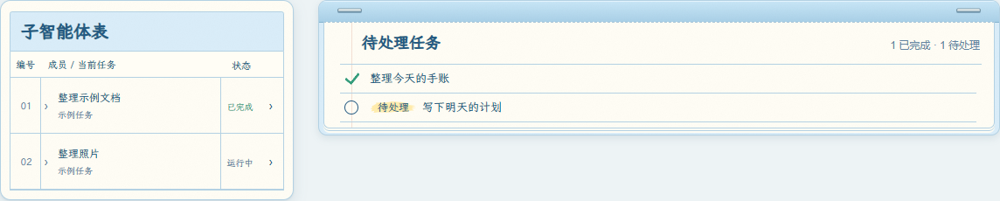

深色 / Dark

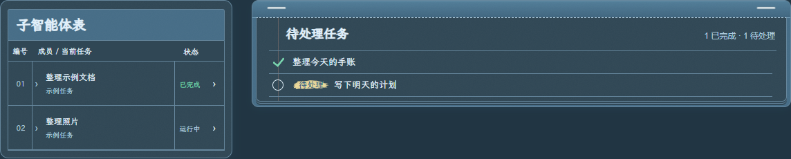

## 交付文件 / Deliverables

Markdown、PDF、Word、Excel、演示文稿与图片文件贴纸。 / File stickers for Markdown, PDF, Word, Excel, presentations and images.

**浅色 / Light**

深色 / Dark

## 会话统计 / Session statistics

用时记录与 Token 用量纸卡。 / Timing records and token-usage cards.

**浅色 / Light**

深色 / Dark

## 菜单与时间选择 / Menus and time picker

自动化任务菜单、时间选择浮层、后台任务菜单与终端菜单。 / Automation menu, time picker, background tasks and terminal menu.

**浅色 / Light**

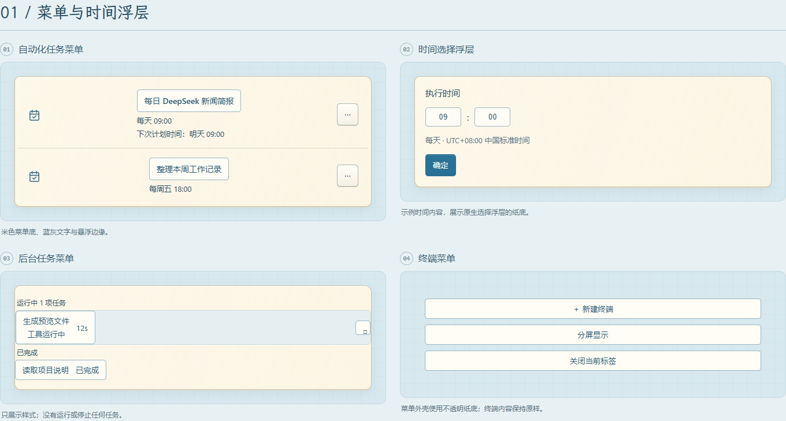

深色 / Dark

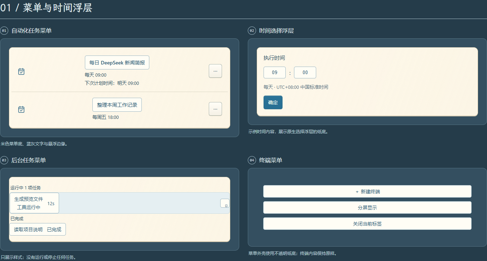

## 审批、问题与插件卡片 / Approval, question and plugin cards

审批提示、问题确认、工具参数输入和插件发现列表。 / Approval prompts, questions, tool parameters and plugin discovery.

**浅色 / Light**

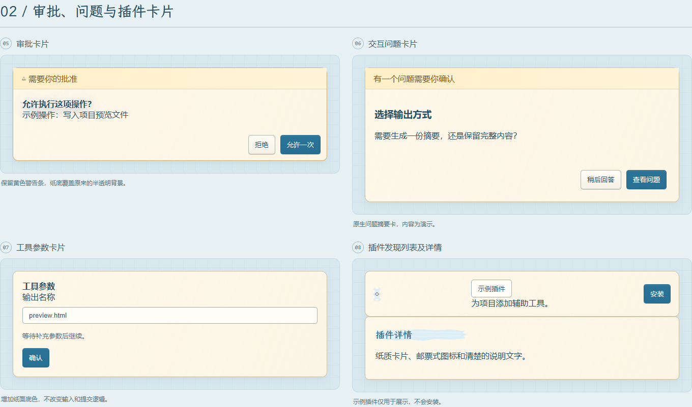

深色 / Dark

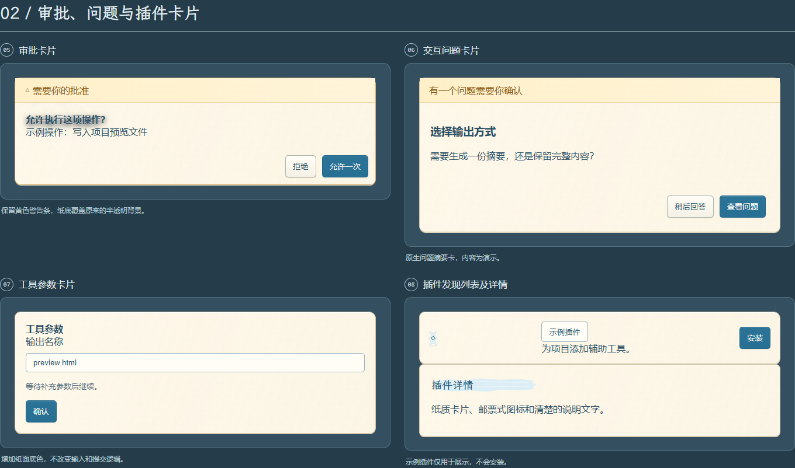

## 工具面板 / Tool panels

远程连接、技能浏览、模型能力与右侧文件／终端／预览面板外壳。 / Remote connections, skills, model capabilities and the file/terminal/preview panel shell.

**浅色 / Light**

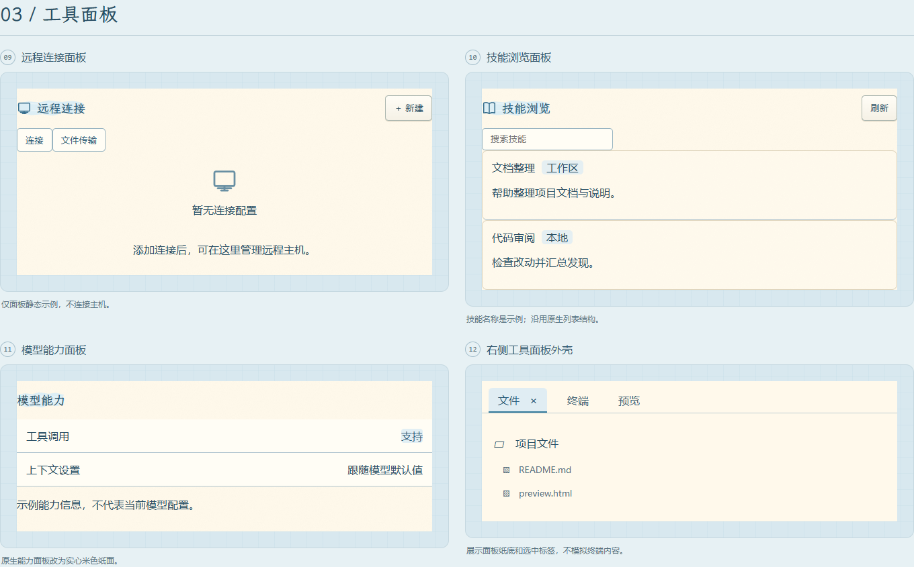

深色 / Dark

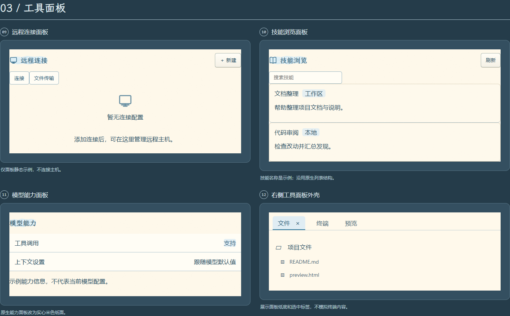

## 通用弹窗 / Generic dialogs

米色不透明纸面、标题、说明与操作按钮。 / Opaque paper background, heading, description and action buttons.

**浅色 / Light**

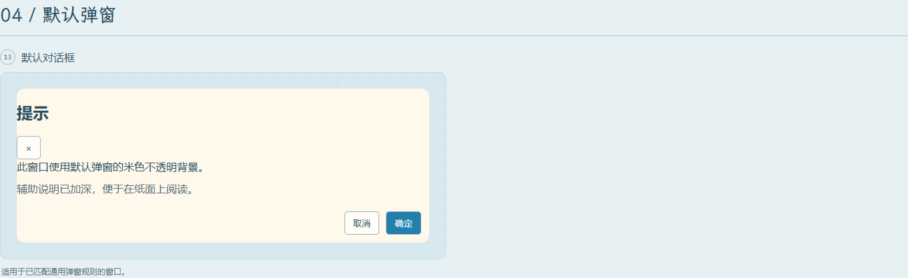

深色 / Dark

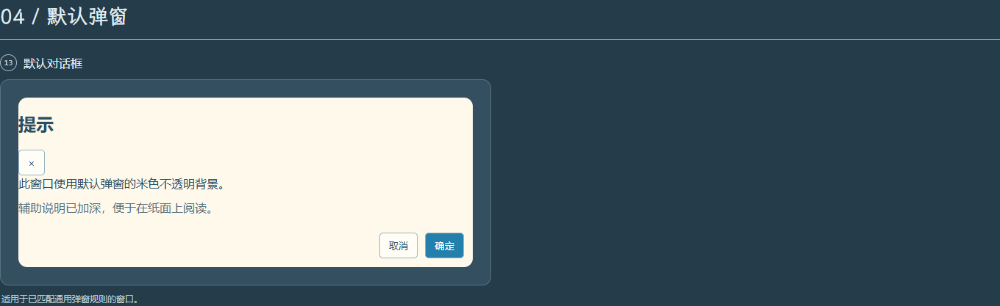

