# 组件静态预览 / Static component previews

[返回首页 / Back to README](../README.md) · [实机窗口截图 / Actual DSH windows](../README.md#效果预览) · [DIY 样式菜单 / DIY style menu](https://github.com/Alphazerolan/diy-journal-settings)

这里按实际功能展示经过专门设计并已实装的皮肤组件。每节分别说明组件的用途与视觉设计，同一功能的收起／展开状态放在一起。仅统一适配底色、边框等默认样式的菜单、卡片与弹窗不在本页展示。

This gallery groups specially designed, implemented skin components by their actual function. Each section explains both purpose and visual design, keeping collapsed and expanded states together. Generic menus, cards and dialogs that only received shared surface styling are omitted.

图片使用当前发布皮肤样式与虚构示例数据生成，属于静态展示，不是运行中 DSH 的截图，也不会执行任务。首页保留实机窗口截图。每组含浅色与深色；图片不包含个人信息或宠物。排版与可用信息可能随 DSH 版本、窗口大小和内容变化。

Images use the released skin styles and fictional sample data. These are static examples, not running DSH screenshots or executable tasks. Actual window captures remain in the README. Each group includes light and dark variants, without personal information or pet artwork. Layout and available information may vary with DSH version, window size and content.

## 目录 / Contents

- [对话气泡 / Conversation bubbles](#messages)
- [消息输入区 / Message composer](#composer)
- [会话状态：小飞机 / Session status: paper planes](#planes)
- [触发通知：信封与展开信纸 / Trigger notifications: envelope and letter](#notifications)
- [右侧工作区入口 / Right workspace launcher](#workspace)
- [工作区悬浮信息 / Workspace hover information](#workspace-hover)
- [个人账户卡签 / Account card and tab](#account)
- [子智能体任务列表 / Subagent task list](#subagents)
- [对话待办事项 / Conversation to-dos](#todos)
- [任务看板 / Task board](#taskboard)
- [交付文件 / Deliverable files](#files)
- [会话统计与上下文 / Session statistics and context](#stats)

## 对话气泡 / Conversation bubbles

**功能：** 承载用户消息与助手回复，包括回复中的代码内容。

**Function:** Displays user messages and assistant replies, including code within replies.

**设计：** 用户方格便签、助手横线信纸、署名与回形针。

**Design:** Grid-paper user notes, lined assistant letters, signature and paper clip.

### 浅色 / Light

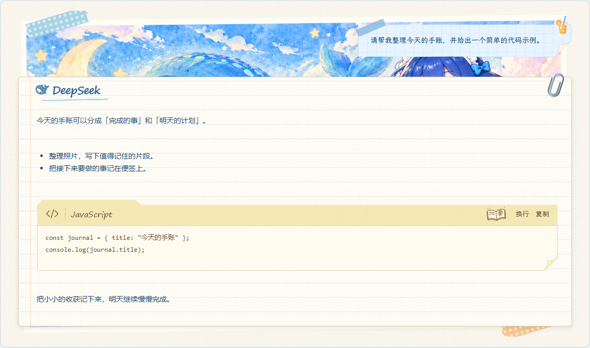

深色 / Dark

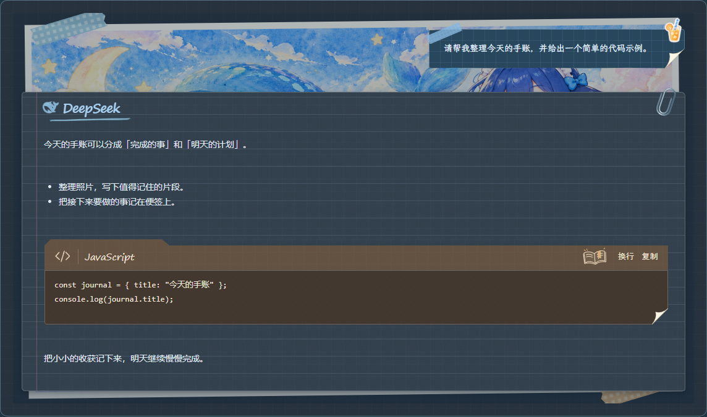

## 消息输入区 / Message composer

**功能：** 编写消息，并选择工作区、模式和分支等会话选项。

**Function:** Compose messages and choose conversation options such as workspace, mode and branch.

**设计：** 可撕方格本输入框、西瓜装饰与纸签式选项。

**Design:** A tear-off grid notebook, watermelon decoration and paper-label controls.

### 浅色 / Light

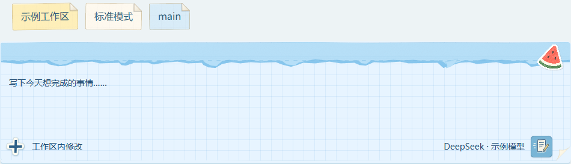

深色 / Dark

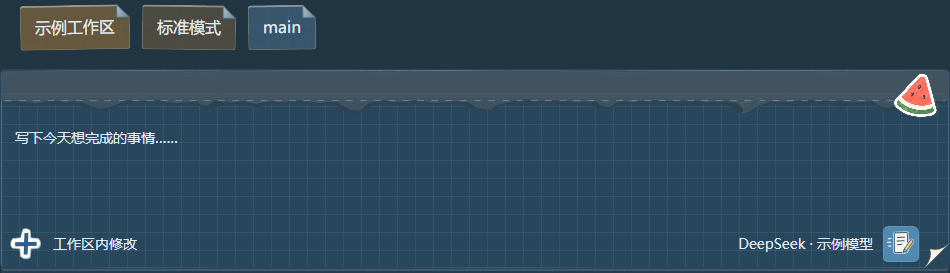

## 会话状态：小飞机 / Session status: paper planes

**功能：** 区分当前会话、运行中的会话和后台任务状态。

**Function:** Distinguishes the current session, running sessions and background activity.

**设计：** 用不同颜色的小飞机标记状态；飞行动画在这里呈现为静止画面。

**Design:** Colored paper planes act as status markers; flight animations appear as still frames here.

### 浅色 / Light

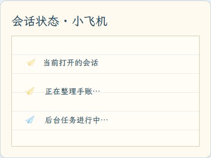

深色 / Dark

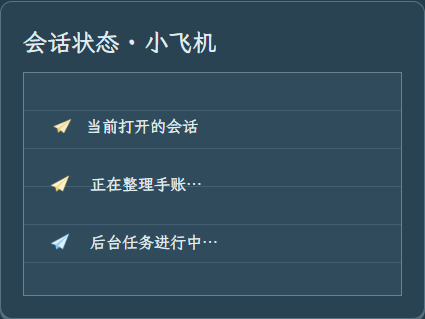

## 触发通知：信封与展开信纸 / Trigger notifications: envelope and letter

**功能：** 解释是什么事件触发了当前这轮对话，例如定时计划。点击通知可展开或收起来源与说明；它不是折叠会话的入口。

**Function:** Explains the event that started a turn, such as a scheduled trigger. Expand or collapse the notice to see its source and details; it is not a collapsed conversation.

**设计：** 收起状态为封好的信封，展开状态为从同一信封中露出的信纸。两个状态属于同一个通知组件。

**Design:** The closed envelope unfolds into a letter in its pocket. Both states belong to the same notification component.

### 收起通知 / Collapsed notice

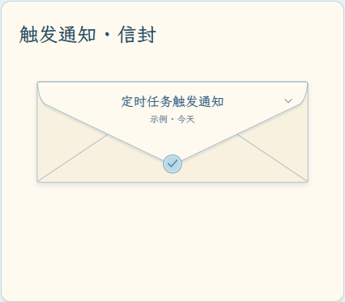

深色 / Dark

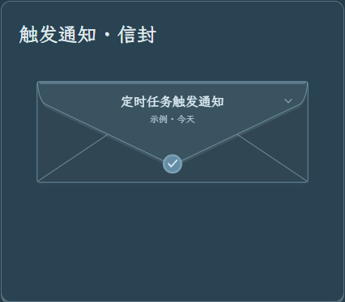

### 展开通知 / Expanded notice

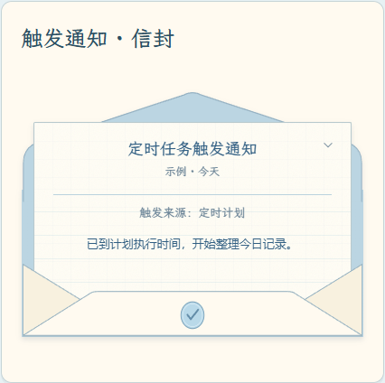

深色 / Dark

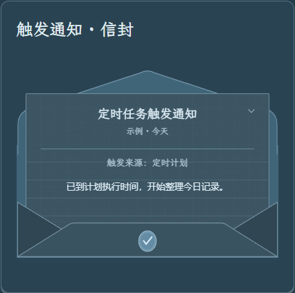

## 右侧工作区入口 / Right workspace launcher

**功能：** 提供项目文件、终端与浏览器的入口，方便在会话旁打开工作工具。

**Function:** Provides entries for project files, terminal and browser alongside the conversation.

**设计：** 蓝色夹板、金属夹、手绘工作区标题与不同颜色的入口卡片。

**Design:** A blue clipboard, metal clip, hand-drawn workspace heading and colored entry cards.

### 浅色 / Light

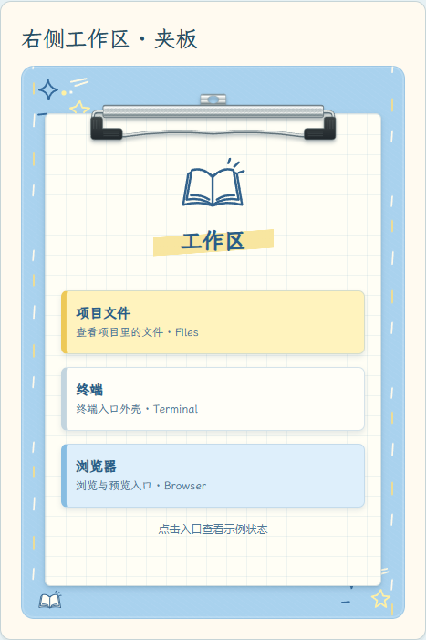

深色 / Dark

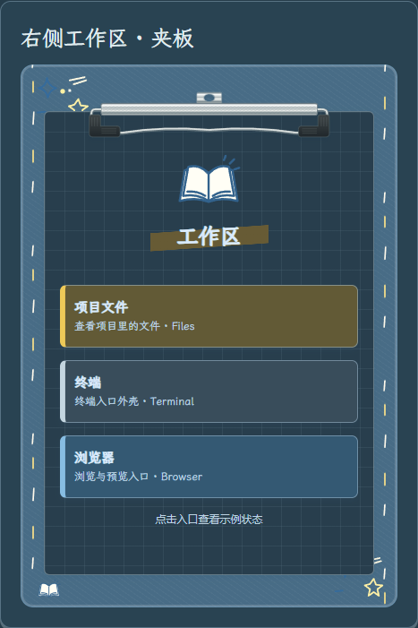

## 工作区悬浮信息 / Workspace hover information

**功能：** 悬停查看工作区名称、目录与最近活动时间。

**Function:** Shows the workspace name, directory and recent activity when hovered.

**设计：** 将信息浮层绘成带标签和叠层纸页的文件夹。

**Design:** A tabbed folder with layered paper replaces the plain information popover.

### 浅色 / Light

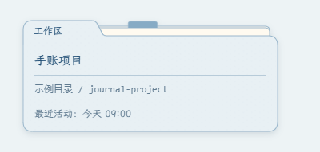

深色 / Dark

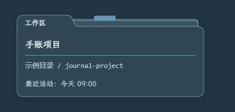

## 个人账户卡签 / Account card and tab

**功能：** 显示当前账户，点击账户卡打开相关菜单；上方的“设置”标签标识这一入口区域。

**Function:** Displays the current account and opens its menu when clicked; the Settings tab marks this entry area.

**设计：** 邮票式头像、手写下划线、蓝色纸袋底托与黄色设置卡签。

**Design:** A postage-stamp avatar, handwritten underline, blue paper pocket and yellow Settings tab.

### 浅色 / Light

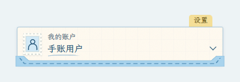

深色 / Dark

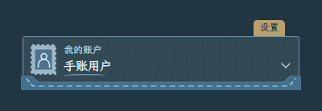

## 子智能体任务列表 / Subagent task list

**功能：** 查看委派给子智能体的任务、成员及其运行或完成状态。

**Function:** Inspect delegated tasks, subagent members and their running or completed states.

**设计：** 带编号、成员／当前任务及状态列的蓝色登记表。

**Design:** A blue register with numbered rows, member/current-task and status columns.

### 浅色 / Light

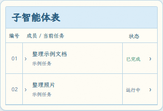

深色 / Dark

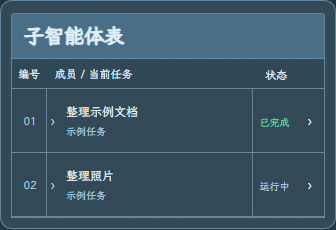

## 对话待办事项 / Conversation to-dos

**功能：** 展示当前对话中的待办步骤与完成进度，与子智能体成员列表分别展示。

**Function:** Shows the checklist and completion progress within a conversation, separately from subagent membership.

**设计：** 装订笔记本、待处理标记、圆圈与完成勾选。

**Design:** A bound notebook with pending markers, circles and completed checkmarks.

### 浅色 / Light

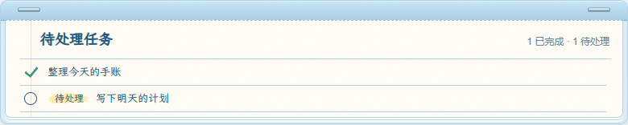

深色 / Dark

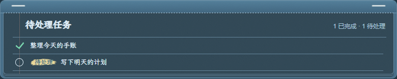

## 任务看板 / Task board

**功能：** 按状态浏览和管理任务，并提供搜索与新建入口。图中展示待处理、进行中和已完成三列。

**Function:** Browse and manage tasks by status, with search and create actions. The example shows pending, running and completed columns.

**设计：** 点纹纸底、手写标题、彩色栏目标签和独立纸质任务卡片。

**Design:** Dotted paper, a handwritten heading, colored column tabs and individual paper task cards.

### 浅色 / Light

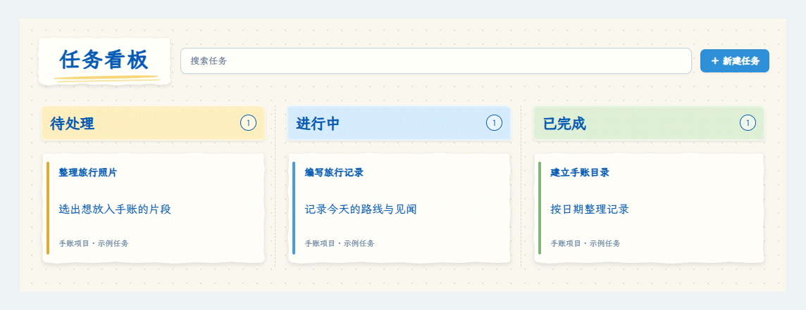

深色 / Dark

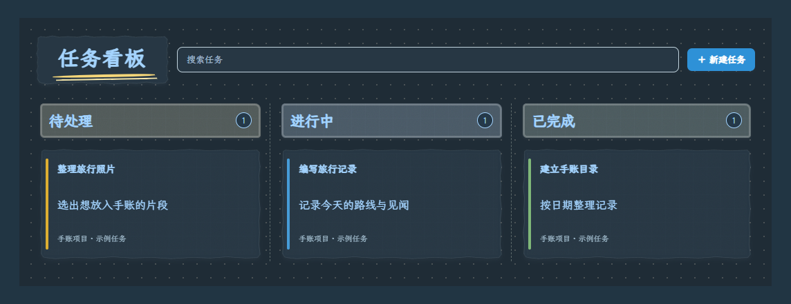

## 交付文件 / Deliverable files

**功能：** 展示助手交付的文件，帮助按名称和类型识别要打开的成果。

**Function:** Presents files delivered by the assistant, making outputs recognizable by name and type.

**设计：** 为 Markdown、PDF、Word、Excel、演示文稿与图片绘制不同的文件贴纸。

**Design:** Distinct file stickers for Markdown, PDF, Word, Excel, presentations and images.

### 浅色 / Light

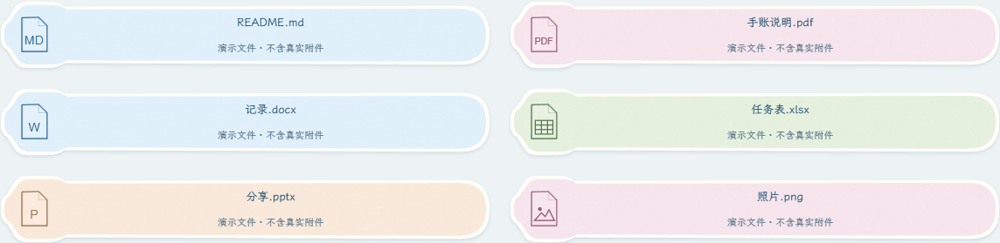

深色 / Dark

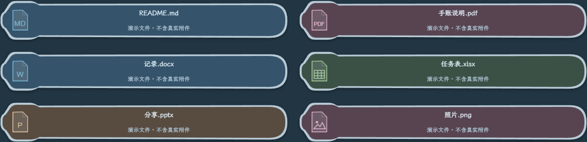

## 会话统计与上下文 / Session statistics and context

**功能：** 上下文卡片显示当前容量占用及系统提示、工具定义、对话消息等组成；用时卡片记录模型和工具耗时；Token 卡片显示输入、输出与缓存信息。上下文占用不等同于累计 Token 用量。

**Function:** The context card shows current capacity usage and its system-prompt, tool-definition and message breakdown. Timing records cover model/tool durations; token statistics show input, output and cache information. Context occupancy is distinct from accumulated token usage.

**设计：** 从左到右为上下文索引卡、用时记录纸和 Token 用量纸卡。点击输入区的上下文占用指示可查看上下文卡片，具体数据取决于模型提供的信息。

**Design:** Left to right: a context index card, timing record and token ledger. Click the context indicator in the composer to open its card; available figures depend on the model provider.

### 浅色 / Light

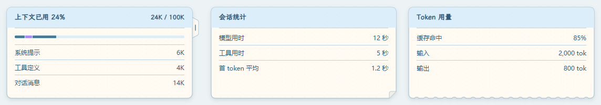

深色 / Dark

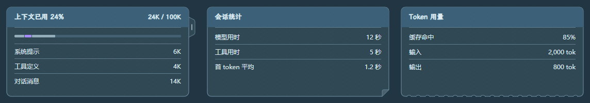

