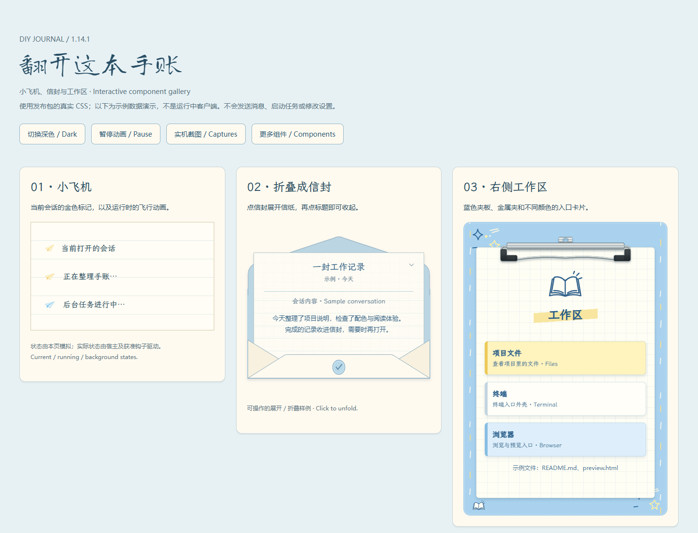
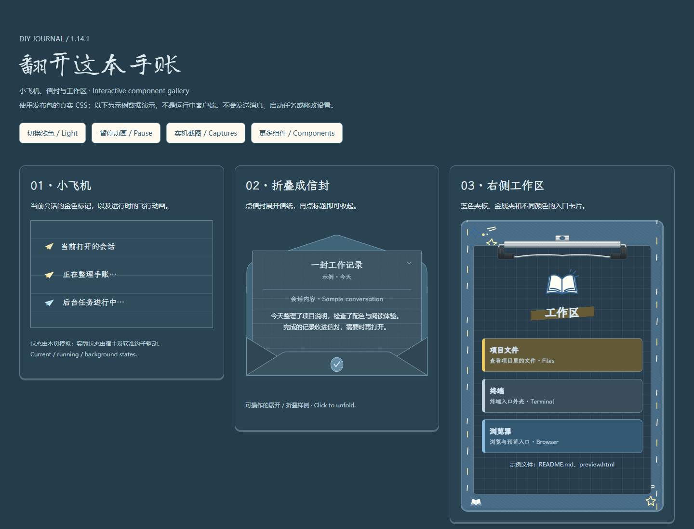
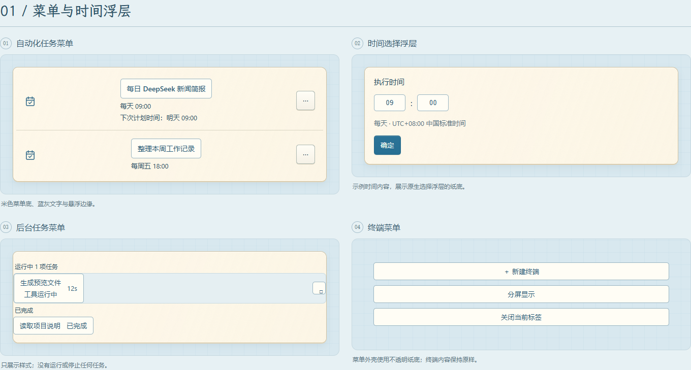
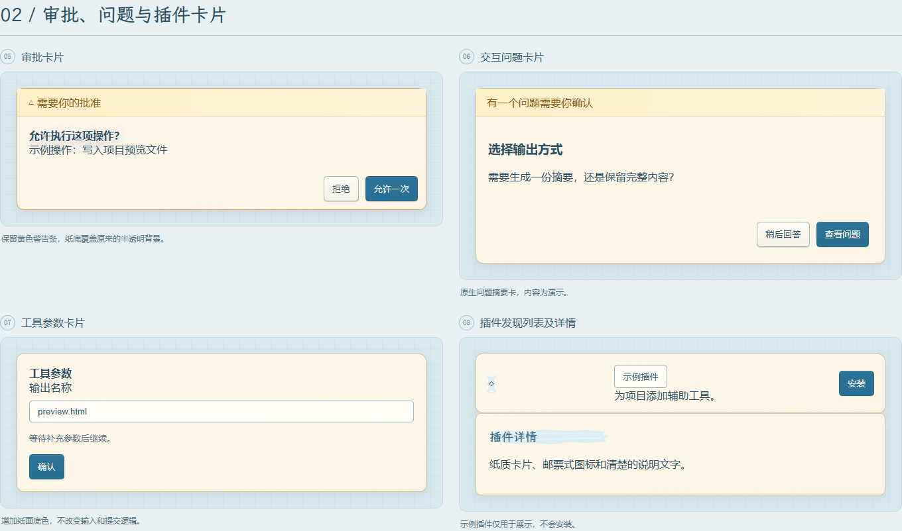
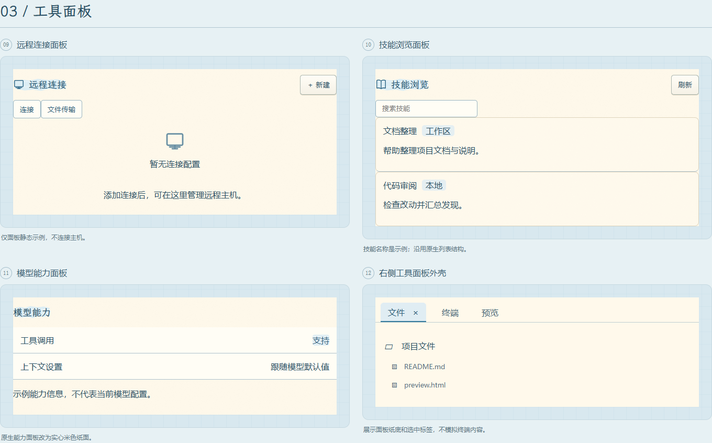
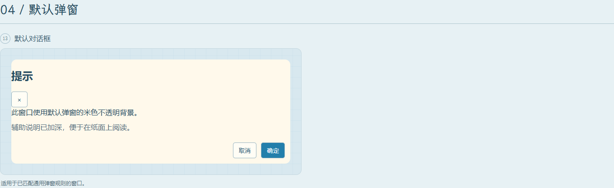

# 皮肤改动导览 / Skin feature tour

[安装](../INSTALL.md) · [可交互演示源文件](demo/index.html) · [English package guide](../skins/diy-journal/README.md)

## 三个可操作示例 / Three interactive examples

下载完整仓库后用浏览器打开 `docs/demo/index.html`。
可切换浅色／深色、暂停小飞机动画、展开／折叠信封、点击右侧工作区入口。
这些内容使用当前发布 CSS 和虚构数据，展示布局与状态，不连接 Harness 服务。
实际客户端是否启用动态增强取决于宿主状态和钩子审批。

Open the demo locally to toggle themes, pause motion, unfold the envelope and
inspect workspace entry states. These fixtures use shipped CSS and sample data;
they are not recordings of a running conversation or proof of hook approval.

## 覆盖区域 / Styled surfaces

| 区域 / Surface | 主要改动 / Treatment | 展示位置 / Demonstration |
| --- | --- | --- |
| 主界面 / Home | 手账本标题、纸面、照片白边和胶带，保留“探索未至之境” | README 实机截图 |
| 左侧栏 / Left sidebar | 装订边、书本式工作区、选中会话笔刷底、小飞机、纸质用量卡 | README 完整左栏截图；小飞机示例 |
| 折叠内容 / Collapsed conversation | 封口信封、展开的信纸与信封袋 | 可交互信封示例 |
| 右侧工作区 / Right workspace | 蓝色夹板、金属夹、文件／终端／浏览器彩色卡片 | 可交互工作区示例 |
| 设置 / Settings | 纸面页、左栏 Q 版贴纸、各页独立配图与卡片 | README 设置截图；ARTWORK.json 逐图记录 |
| 账户与远程访问 / Account and remote access | 账户纸卡、电话簿按钮、远程访问电话本封面与索引标签 | 皮肤组件及主界面截图 |
| 自动化 / Automation | 手账任务条、任务菜单、时间浮层 | 下方菜单图 |
| 审批与问题 / Approval and questions | 米色纸卡、警告条、蓝色操作按钮 | 下方卡片图 |
| 插件、技能、模型 / Plugins, skills, models | 邮票图标、纸质列表、能力卡片 | 下方卡片与面板图 |
| 工具与终端 / Tools and terminal | 参数卡、后台任务菜单、面板标签外壳 | 菜单及面板图 |
| 归档和会话预览 / Archive and session preview | 手写标题、信息分区、纸面弹窗 | 当前皮肤规则；本页未另拍实机图 |
| 普通弹窗 / Generic dialogs | 不透明米色底、清楚的文字和按钮 | 默认弹窗示例 |
| DIY 样式 / Optional editor | 自选照片、单双照片、尺寸角度、宽窄白边与题字、胶带颜色纹样分离 | 独立设置插件仓库 |

此表说明已有适配范围，不代表未来每个 Harness 版本的所有窗口均已验证。
外部网页、终端实际输出和文档画布不由本页模拟。This inventory is not a
guarantee of exhaustive compatibility with future Harness releases.

## 菜单 / Menus

## 卡片 / Cards

## 面板 / Panels

## 默认弹窗 / Generic dialog

## 截图边界 / Capture scope

`evidence/` 是实际应用的完整窗口截图，保留左栏、隐藏无授权宠物，并在截图前
遮盖账户、余额、项目名和会话名。`docs/demo/` 是独立示例页面的渲染图，使用虚构
内容，不包含宠物素材、账户信息或本地项目路径。

`evidence/` contains native app captures with personal text masked and the
unlicensed pet hidden before capture. `docs/demo/` contains isolated fixtures
with fictional content and no pet artwork.
